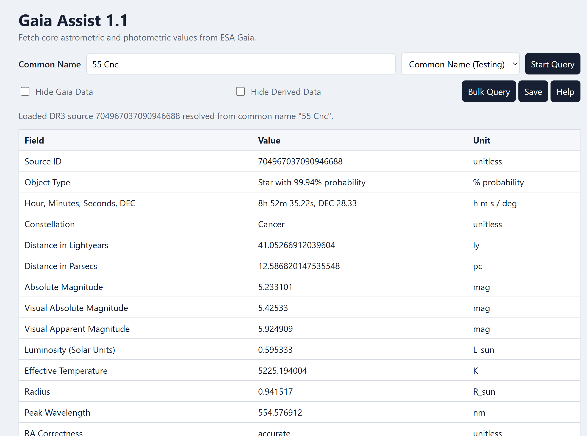
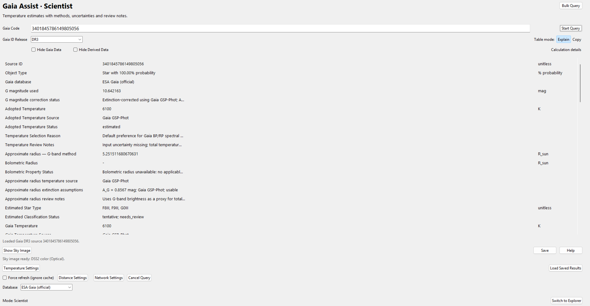
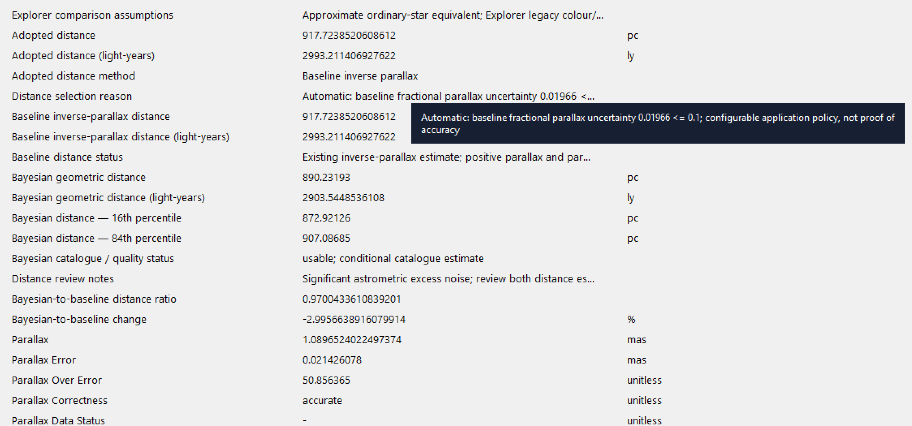
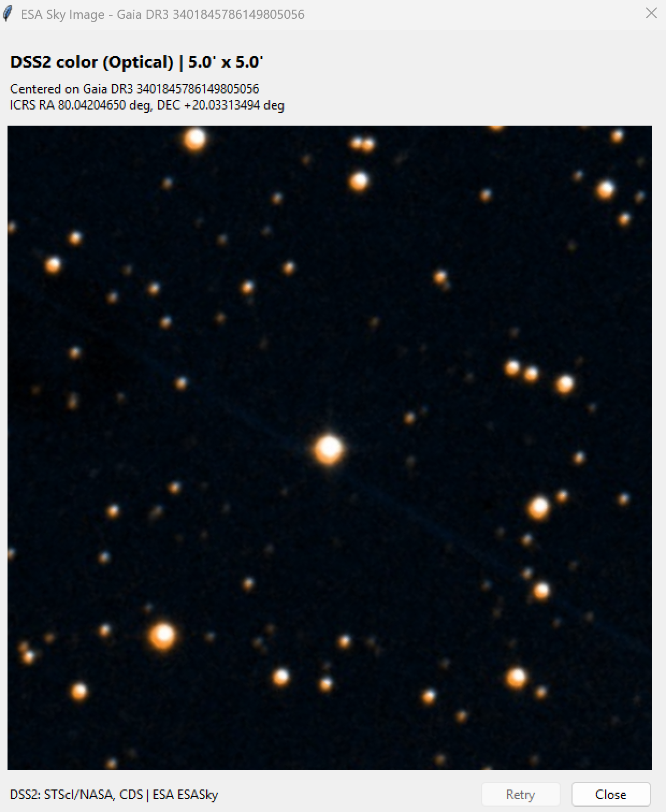
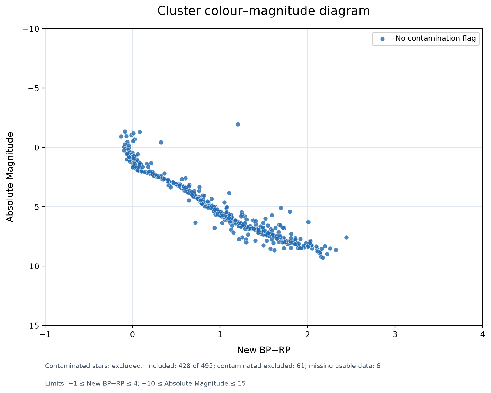

# Gaia Assist

**Turn a Gaia source ID into a stellar profile in one query.** Gaia Assist is an open-source Python app for exploring Gaia Data Release 3 (DR3). Get a first look at a star with little information in other catalogues, or analyse a list of sources for follow-up.

- **Look up one source.** See Gaia measurements such as parallax and apparent G magnitude alongside estimates of **distance, absolute magnitude, effective temperature, radius and stellar type**, where the data support them.
- **Run a bulk query.** Paste a list of IDs or load a TXT or CSV file. Choose the result columns, export a table for further analysis, or use the desktop app to make colour–magnitude diagrams and stellar classification charts.

**[Download and install](#installation-and-desktop-setup)** · **[Try online](https://gaia-assist.onrender.com)** · **[GitHub releases](https://github.com/Coma-Berenices2/Gaia-Assist/releases)**

**Explorer** gives you a first look at the results, with clickable field explanations and approximate calculations. **Scientist** lets you compare temperature and distance estimates, see which values were adopted and why, and save results with sources, assumptions, available uncertainties and review notes.

**Public Beta.** Gaia Assist is an independent community project. Scientific validation is ongoing. Review the inputs, assumptions and quality warnings before using derived results in scientific work.

[Using Gaia Assist](#using-gaia-assist) · [Scientist results](#understand-scientist-results) · [Bulk queries and charts](#query-several-objects) · [Saving results](#save-and-reopen-your-work) · [Browser setup](#optional-use-a-browser-interface) · [Scientific limitations](#scientific-limitations) · [Examples](#examples)

## Installation and desktop setup

### 1. Download the application

On the [Gaia Assist GitHub repository](https://github.com/Coma-Berenices2/Gaia-Assist), choose **Code → Download ZIP** and extract the full application. Keep the Python files and `requirements.txt` together so `Main.py` can load the other modules.

You need **Python 3.10 or newer**, internet access for catalogue queries, and a writable application folder. The application has been tested on Windows with Python 3.13; macOS and Linux have not been fully verified. No Gaia API key or GitHub account is required.

### 2. Install and launch on Windows

Install Python with its **Tcl/Tk** component enabled. Open PowerShell or Terminal in the extracted folder containing `Main.py` and `requirements.txt`, then run these commands one at a time:

```powershell
py -m venv .venv
.\.venv\Scripts\python.exe -m pip install -r requirements.txt
.\.venv\Scripts\python.exe Main.py
```

The first two commands prepare the application. **For later visits, run only the last command** from the same folder.

If Windows does not recognize `py`, try `python` in the first command. The environment does not need to be activated.

<details>
<summary>macOS and Linux setup</summary>

With Python and Tkinter installed, open a terminal in the extracted application folder:

```sh
python3 -m venv .venv
.venv/bin/python -m pip install -r requirements.txt
.venv/bin/python Main.py
```

For later visits, run only the last command. Some Linux distributions provide Tkinter as a separate system package; install the package matching your Python version if the application reports that `tkinter` is missing.

</details>

### 3. Choose a mode

Choose **Explorer** or **Scientist** in the launcher. Scientist is the focus of ongoing scientific improvements. Check each estimate's assumptions and review notes for the star you are analysing.

## Using Gaia Assist

Launch the desktop app or open the [hosted demo](https://gaia-assist.onrender.com), then choose **Explorer** for a first look or **Scientist** for method comparisons and review notes. The hosted demo can take a moment to start. If a Scientist query stops after showing a preview, use the local build to complete the workflow.

### Look up a source

1. Select the input catalogue, normally **DR3**.
2. Enter the object's numeric Gaia source ID. For DR1 or DR2 IDs, choose the matching release; the application searches for its DR3 counterpart.
3. Click **Start Query** and wait for the results. In Scientist mode, initial results can appear before optional information finishes loading.
4. Review the Gaia measurements, quality indicators and calculated properties. In Scientist, open **Calculation details** to see sources, uncertainties where available, and review notes.
5. Click **Save** to keep the result. See [Save and reopen your work](#save-and-reopen-your-work) for supported formats.

To search by an astronomical name, choose **Common Name (Testing)**. Name lookup is experimental: check the matched source and coordinates before using the result.

Use **Name resolver** to choose **SIMBAD / Sesame — France** (default) or **SIMBAD — Harvard (USA)** when France is unavailable. The choice applies to subsequent common-name searches, including bulk queries, in desktop and browser modes. It changes name resolution only; the Gaia database selector still controls Gaia measurements. Desktop preferences are saved locally; browser choices apply to that browser request. A mirror can also be temporarily unavailable, in which case its error is reported rather than treated as a missing object. Include `name_resolver.py` with the other application files when updating.

Use **Switch to Scientist** or **Switch to Explorer** during your session. Each mode retains its own inputs and results while you switch; switching does not automatically run another query.

### Read, explain and copy results

- **Explain** is the default. Click a field name to read its definition.
- Switch to **Copy** to select field names, values and units together.
- In Scientist mode, long values may end in `...`. In Explain mode, click to read the full value; in Copy mode, hover over it to see the full text. Full text is retained when copying and saving.
- Use **Calculation details** in Scientist mode to inspect supporting information and review notes.

### View the surrounding sky

In the desktop application, click **Show Sky Image** to open a separate image window. It shows a **5.0′ × 5.0′ DSS2 colour, Optical** cutout centred on the object's coordinates. Image retrieval follows the numerical results so it does not hold up their initial display. The image window opens only when requested.

## Understand Scientist results

Read a value together with its source and review notes. Missing or unavailable values are not zero.

| Result | How to interpret it |
| --- | --- |
| Gaia measurements | Catalogue values such as parallax, photometry and radial velocity, with errors and quality indicators where available. |
| Adopted temperature | The temperature selected from the available, applicable estimates. Check the recorded source and warnings. |
| Explorer comparison results | Approximate temperature, radius and classification calculated using the original Explorer methods, for comparison with Scientist results. |
| Adopted distance | The distance selected by the current distance policy. Baseline and Bayesian estimates remain separately identifiable. |
| **Approximate radius — G-band method** | Uses G-band brightness as a proxy for total luminosity. Assumes a solar-like bolometric correction; accuracy depends on the stellar spectrum. |
| Bolometric radius | A separate calculation requiring an applicable bolometric correction and valid inputs. It can be unavailable even when the approximate radius is shown. |

When neither Gaia nor the NADC dust map supplies usable G-band extinction, Scientist uses observed **Mean G** directly. **G magnitude correction status** labels it **Not de-dusted**; extinction remains unknown rather than being recorded as zero. Absolute magnitude still requires a valid adopted distance.

Temperature and radius estimates depend on the available measurements and extinction assumptions. Review those assumptions before comparing stars. Carbon-star candidate warnings need particular care: an ordinary-star comparison classification does not replace the carbon-star identification, and a candidate flag is not confirmation.

### Compare temperature estimates

Scientist normally prefers an eligible Gaia estimate. It evaluates GSP-Phot and, where applicable, ESP-HS for hot stars. It also checks BP−RP colour estimates against their calibration domains and available photometry, reddening and stellar inputs. A supported colour estimate can supply a missing temperature or take precedence when the selection policy identifies a specific problem with the Gaia estimate. Differences and unresolved conflicts are recorded with the adopted source and reason.

When no eligible Gaia or supported calibrated colour estimate is available, the default compatibility option can use an approximate Explorer BP−RP estimate. Scientist labels it unvalidated and marks it for review. It uses corrected colour when available and identifies observed colour when used without a reddening correction. There is no formal uncertainty for this fallback. You can disable it in **Temperature Settings**. [Temperature methods and limits](TEMPERATURE_EXPERIMENT.md)

### R1 GSP-Phot model-boundary diagnostic

Scientist checks the catalogue GSP-Phot temperature median against the limits for the atmosphere-model library identified by the catalogue. A fit close to a library edge can be constrained by the grid. Gaia Assist runs this check after temperature selection and retains both the original catalogue value and the adopted estimate. If the adopted estimate is GSP-Phot and the diagnostic flags it, the status becomes `needs_review`. If another method was adopted, the warning refers to GSP-Phot and that other estimate keeps its own status.

| Diagnostic status | Condition |
| --- | --- |
| `not_flagged` | The median is inside the documented range and more than 1 K from either edge. |
| `possible_boundary_constraint` | The median is inside the documented range and at most 1 K from an edge, including the edge itself. Missing or unusable percentiles still allow this warning. |
| `strong_boundary_concern` | The median meets the 1 K rule, and the 16th–84th percentile interval reaches the same edge or lies entirely within 2 K of it. Both bounds must be finite, bracket the median and lie within the documented range. |
| `not_evaluated` | The library or median is missing or unusable, or the median falls outside the reference range. |

The 1 K and 2 K thresholds are provisional heuristics for fits unusually close to a grid edge. They do not give a calibrated probability of error. The check uses the synthetic library limits in Gaia DR3 Table 11.13. The GSP-Phot methods paper gives wider coverage at the MARCS lower and A upper limits, so interpret those alerts with particular care. [Gaia DR3 library limits](https://gea.esac.esa.int/archive/documentation/GDR3/Data_analysis/chap_cu8par/sec_cu8par_data/ssec_cu8par_data_xp.html) · [GSP-Phot methods paper](https://arxiv.org/abs/2206.06138)

Read **Temperature Review Notes** or expand **Calculation details** to inspect the library, status, distance to the boundary in kelvin and specific warning. Scientist preserves these fields in its single and bulk TXT, CSV and JSON exports. [Diagnostic and method details](TEMPERATURE_EXPERIMENT.md#reviewing-a-gsp-phot-temperature-at-a-library-boundary) · [ξ² Centauri example](#reading-an-r1-warning)

### Choose a distance policy

Open **Distance Settings** in Scientist mode:

- **Automatic** is the default. It uses a valid inverse-parallax estimate when fractional parallax uncertainty meets the configured threshold, otherwise preferring a usable published Bayesian geometric distance. The default threshold is 10%.
- **Baseline** uses the inverse-parallax calculation when it passes the application's validity checks.
- **Bayesian geometric** prefers the published geometric distance, with an explicit fallback when needed.

The selected distance affects derived magnitudes, extinction calculations and radius estimates. The threshold is an application setting, not a universal guarantee of accuracy. Selection notes explain which distance was actually used.

Scientist reuses cached catalogue responses where possible. Use force refresh when you need a new service response; changing settings does not always require downloading the same data again. Loading a saved record preserves its recorded calculations.

### Choose a database in Scientist

Use the **Database** selector to choose **ESA Gaia (official)**, **ARI Heidelberg**, **Gaia@AIP**, or **MAST** before starting a single or bulk query. ESA remains the default. Availability can change.

The desktop remembers your choice; it is also available under **Network Settings**. The browser sends the selected database with each query. Changing the choice applies to subsequent queries, and each database uses a separate cache. A running bulk query retains the database it started with. Use **Force refresh** to fetch new responses from that database.

The Gaia source and optional astrophysical parameters come from your selected database. With an alternative selected, published geometric distances come from **GAVO** rather than ESA. The calculated result retains the actual catalogue providers and original retrieval times when available. There is no automatic switch back to ESA on failure. MAST's service is DR3; use a DR3 ID or another provider for DR1 crossmatching.

Restart the app after updating it to use the current database options. Explorer uses its original query path. Sky images and the optional dust-map service remain separate from the database choice.

See [Database selection and verification](SCIENTIST_DATABASES.md) for details.

## Query several objects

1. Open **Bulk Query**.
2. Enter **one object per row**, or use **Load Text File** to load `.txt` or `.csv` input containing one object per row.
3. Choose the input catalogue and result columns.
4. Start the bulk query, review the results, then use **Save Bulk Results** to keep them.

In Scientist's desktop field selector, **View in Categories** groups fields by subject (distance, brightness, colour/temperature, extinction, radius, quality, coordinates and more). Drag a section heading to move that whole group, or drag fields within a section to change their order. Switch back to the default layout to see the same selection and order as a flat grid. Scroll to reach all fields and hover over a box to read its full name. **Select All** deselects everything when all fields are already selected; otherwise it selects everything.

A **blue asterisk** after an object's ID flags potentially problematic measurements: unreliable RUWE, missing or negative parallax, unreliable parallax-over-error, or unreliable corrected excess flux, where those fields are available. Click the asterisk to read the warning. For cluster analysis, consider whether to exclude the flagged object; an unflagged object is not automatically a cluster member.

### Make cluster charts

After a completed desktop bulk query with at least **10 objects**, open **Advanced Cluster Analysis**. Choose whether to include or exclude flagged objects, then generate:

- **Colour–magnitude diagram (CMD):** New BP−RP runs left to right from −1 to 4; absolute magnitude runs from −10 at the top to 15 at the bottom. Objects outside these ranges, or without the necessary values, are omitted.
- **Spectral classification grid:** spectral subtypes run across the columns and luminosity classes down the rows. Each cell shows an object count. When an object has several estimated types, only the first listed type is counted. Scientist treats carbon-star candidates separately from the ordinary classification grid.

Save figures as **PNG, PDF or SVG**, and chart data as **CSV**. These charts help explore the selected objects; they do not determine cluster membership by themselves.

## Save and reopen your work

Explorer saves text results in `saved_objects/`. Scientist saves single and bulk results as TXT, CSV and JSON in `saved_objects_temperature/`. The application creates these folders as needed.

In Scientist mode, use **Load Saved Results** to reopen a saved JSON or supported older text record. **Prefer JSON for reopening:** it retains the full record, including sources, assumptions and settings. CSV is useful for tables and further analysis; text is convenient for reading.

Older imported records retain their historical values. Loading them does not automatically recalculate them with the current model. Keep a backup of your saved-results folders before replacing or updating the application.

## Optional: use a browser interface

Use the desktop application for sky-image windows and advanced cluster charts. To use a local browser interface on Windows, run the following from the application folder after installation.

```powershell
$env:HOST = '127.0.0.1'
.\.venv\Scripts\python.exe WebMain.py
```

Open `http://127.0.0.1:65000/`, choose **Explorer** or **Scientist**, and use the switch button at the top to change modes. Both run on the same server. Each workspace retains its inputs and results while switching; refreshing or closing the browser page ends that unsaved session.

`WebMain_temperature.py` also opens the combined interface, on port 65001 by default. Render uses `WebMain.py` and its assigned port. If a different port is configured, use the address printed in the terminal.

Keep the terminal open while using the interface. Press **Ctrl+C** there to stop it. Browser saves are written to the computer running the application. Browser and desktop features are not identical. The local command above restricts access to your own computer.

## Troubleshooting

| Problem | What to try |
| --- | --- |
| `Main.py` or `requirements.txt` cannot be found | Open the terminal in the extracted folder containing those files. |
| A Python module is missing | Repeat the installation command above, then launch with the same `.venv` Python executable. Keep all downloaded Python files together. |
| `tkinter` is missing | Install Python's Tcl/Tk component or the matching Tkinter system package. It is not installed through `requirements.txt`. |
| The window closes immediately | Launch from a terminal using the command above so you can read the error. |
| A query fails or takes too long | Check your connection, input ID and selected release. Catalogue services can be temporarily unavailable; retry later. Scientist also provides cancellation and network timeout settings. |
| Temperature, distance or radius is unavailable | Read the source/status and review notes. The required data may be missing, invalid or outside a method's supported range. |
| A sky image does not load | The image service may be unavailable even when Gaia results succeed. Retry the image later. |
| A star is missing from a chart | Check its required values, plot range, estimated classification and the include/exclude setting for flagged objects. |
| Results cannot be saved | Move the application to a writable folder and check the save error. |

## Scientific limitations

- **Derived parameters require independent validation before publication-quality use.** Some methods remain under scientific review; inspect the source data, method references and recorded assumptions.
- A suggested stellar classification is an estimate, not a measured spectral type. Population charts and quality flags do not confirm cluster membership; an unflagged object is not automatically a member.
- Temperature and radius estimates depend on available measurements, supported method ranges and extinction assumptions. The approximate G-band radius assumes a solar-like bolometric correction; read the [Scientist results](#understand-scientist-results) guidance before interpreting it.
- Missing or unavailable values are not zero. When extinction is unavailable, Scientist labels the G magnitude **Not de-dusted** rather than treating extinction as zero.
- **Common Name (Testing)** lookup is experimental. Verify the matched source and coordinates. Carbon-star candidate flags also require review and do not confirm a carbon-star identification.

Gaia Assist is developed independently of ESA. See [Data credits and licence](#data-credits-and-licence) for the Gaia data acknowledgement.

## Learn more about the methods

For calculation details, assumptions and references:

- [Temperature methods and limitations](TEMPERATURE_EXPERIMENT.md)
- [Distance selection](SCIENTIST_DISTANCE.md)
- [Explorer comparisons and approximate radius](SCIENTIST_COMPARISON_AND_RADIUS.md)
- [Catalogue requests, caching and carbon-star handling](SCIENTIST_NETWORK_AND_CARBON.md)

## Examples

### Screenshots

These October 2026 captures show a browser lookup and the desktop Scientist workflow.

#### Explorer lookup

Explorer resolves **55 Cnc** using the experimental common-name lookup and displays its Gaia source ID alongside estimated distance, magnitudes, temperature and radius.



#### Scientist results and distance comparison

Scientist shows the catalogue provider, the adopted temperature and its source, and review notes alongside an approximate radius and tentative stellar classification.



The distance panel shows both the inverse-parallax estimate and the Bayesian geometric estimate, with an explanation of why **Automatic** chose the former.



#### Desktop sky image

**Show Sky Image** opens a 5.0′ × 5.0′ DSS2 colour cutout centred on the selected Gaia source in a separate desktop window. Image credits shown in the app are DSS2 (STScI/NASA, CDS) and ESA ESASky.



### Case study: NGC 2546A

1. **Candidate selection outside Gaia Assist.** A separate astrometric analysis identified a concentration in Gaia DR3 parallax and proper motion and produced a list of **495 candidate source IDs**.
2. **Bulk analysis in Gaia Assist.** The ID list was imported into Scientist using **Bulk Query → Load Text File** with **DR3** selected. ARI Heidelberg supplied all 495 source rows during an ESA storage issue. Gaia Assist processed the catalogue data, exported per-source results and produced the desktop colour–magnitude diagram and spectral classification counts. In the 11 October 2026 export, **377 of 495** sources adopted a Gaia catalogue temperature (**343 GSP-Phot** and **34 ESP-HS**). The CMD showed **428** sources after **61** quality exclusions and **6** with missing usable CMD values.
3. **Research interpretation outside Gaia Assist.** Follow-up analysis used the exports and figures to examine the candidate population and assess how distance and extinction assumptions affected the CMD. The diagram explores an externally selected sample. Membership, a calibrated cluster metallicity and an isochrone age remain open.

This workflow shows how to take a candidate list from an external analysis into Gaia Assist and get inspectable results for further work. Cluster membership analysis, scientific validation, extinction-corrected CMD analysis and isochrone fitting remain areas of ongoing research.



*NGC 2546A candidate sample. The chart plots 428 of 495 input sources. The legend's “No contamination flag” means that the plotted sources passed the app's chart exclusion rules. Field stars can still be present.*

### Reading an R1 warning

For **ξ² Centauri** (Gaia DR3 `6081542475600377472`), the GSP-Phot median is **9,999.6045 K**, only **0.3955 K** below the PHOENIX upper limit of **10,000 K**. The reported interval, **9,998.639–9,999.912 K**, lies within 2 K of that limit, which meets the `strong_boundary_concern` criterion. The interface displays the rounded temperature and the saved record retains full precision.

## Data credits and licence

Gaia Assist uses data from the European Space Agency (ESA) mission Gaia, processed by the Gaia Data Processing and Analysis Consortium (DPAC). DPAC receives funding from national institutions, especially those participating in the Gaia Multilateral Agreement. For publications using these data, follow the [Gaia DR3 credit and citation guidance](https://gea.esac.esa.int/archive/documentation/GDR3/Miscellaneous/sec_credit_and_citation_instructions/).

Gaia Assist is distributed under the [MIT licence](LICENSE).
